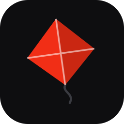

# KiteBar

> Live P&L of your Zerodha holdings in the macOS menu bar — built for the
> **free** Kite Connect Personal plan.

-black)


A native menu bar app that shows your portfolio's day change at
a glance (`▼ -₹28,234 (-2.7%)`, red/green) with a native dropdown: a
portfolio summary card and per-holding rows with rounded day-change pills —
the works, without paying for Kite Connect market-data APIs.

<!-- Add a screenshot at docs/screenshot.png and uncomment:

-->

## Why this exists

Kite Connect's free **Personal plan** blocks every market-data endpoint
(LTP, quote, OHLC, WebSocket ticks) — they all return *"Insufficient
permission for that call"*. But the **holdings endpoint works**, and it
already contains `last_price`, `close_price`, `day_change`, and
`day_change_percentage` for every holding. That's all a portfolio ticker
needs. Positions (`kite.positions()`) are a portfolio endpoint too.
This app uses those two calls and nothing else.

## Features

- **Menu bar title**: total day P&L across holdings, colored green/red,
  refreshed every 5 s during NSE market hours (Mon–Fri 09:15–15:30 IST,
  computed in IST regardless of your Mac's timezone).
- **Dropdown**: portfolio card (current value, day move, invested, total
  P&L with %) and Kite-style three-line holding rows — Qty/Avg with
  overall P&L %, symbol with overall P&L, invested amount with LTP and
  day change % — sorted alphabetically, exactly like the Kite app.
- **Live while open**: the dropdown updates in place every 5 s during
  market hours — values tick without the menu closing or flickering.
- **Positions too**: open and closed intraday/F&O positions (MIS/NRML/
  CNC) in their own section with per-position P&L, and their
  mark-to-market folded into the "today" figure — matching the Zerodha
  app's Day's P&L.
- **Mutual funds too**: your Coin portfolio (`kite.mf_holdings()`, also
  allowed on the free plan) gets its own section — units, avg NAV,
  invested, latest NAV, and per-fund P&L. NAVs only change once a day,
  so this is refreshed every 30 minutes.
- **Correct math**: uses `quantity + t1_quantity` (unsettled T1 shares
  count!) so totals match the Zerodha app exactly.
- **Daily-login aware**: Kite access tokens die every morning (~6 AM IST).
  The app caches the day's token, and when it expires flips to **⚠️ Login**
  instead of crashing; one click re-authenticates via your browser.
- **Auto-login on expiry** (toggle in the menu, on by default): when the
  session dies, the app opens the Kite login page itself — with an active
  kite.zerodha.com browser session the redirect completes with zero
  typing. Never fires after a *failed* login (no browser-tab loops) and
  at most once per 10 minutes.
- **Keychain-only secrets**: API key/secret live in the macOS Keychain.
  Nothing is hardcoded, nothing sensitive is committed.
- **Strictly read-only**: no order endpoints are ever called; no static IP
  needed.
- **Light on the API**: outside market hours it fetches once (plus once on
  wake from sleep) and idles. Transient network errors retry quietly; a
  small `⚠` marks stale data after repeated failures.

## Prerequisites

1. A [Zerodha](https://zerodha.com) account.
2. A (free) Kite Connect app: create one at
   [developers.kite.trade](https://developers.kite.trade/apps) and set its
   **Redirect URL** to exactly:

   ```
   http://127.0.0.1:8000/callback
   ```

   The app runs a tiny local HTTP server on that address — only while a
   login is in progress — to catch the `request_token`.

## Install

### Homebrew (recommended)

```sh
brew install --cask shameemshah/tap/kitebar
xattr -rd com.apple.quarantine /Applications/KiteBar.app
```

The `xattr` line is needed because KiteBar isn't notarized (no Apple
Developer subscription — it's a free, open-source tool). Without it,
macOS refuses to launch the app, claiming it is "damaged", and offers to
move it to the Trash. (On Homebrew < 6 you can instead pass
`--no-quarantine` to the install; Homebrew 6 removed that flag.)

### Direct download

Grab `KiteBar-<version>.dmg` from the
[latest release](https://github.com/shameemshah/kitebar/releases/latest),
drag **KiteBar.app** to Applications, then clear the quarantine flag
before first launch:

```sh
xattr -rd com.apple.quarantine /Applications/KiteBar.app
```

### Requirements

- Apple Silicon Mac (M1 or later), macOS 11+.
- A free Kite Connect app (see Prerequisites above) — takes 2 minutes.

> Upgrading from the old ZerodhaBar script? KiteBar migrates your Keychain
> credentials, token and settings automatically on first launch.

### Run from source (development)

```sh
git clone https://github.com/shameemshah/kitebar.git
cd kitebar
python3 -m venv .venv
.venv/bin/pip install -r requirements.txt
/usr/libexec/PlistBuddy -c 'Add :CFBundleIdentifier string "com.shameemshah.kitebar"' .venv/bin/Info.plist
```

> The `PlistBuddy` line gives the bare venv interpreter a bundle identifier
> so macOS Notification Center alerts work (rumps needs one). Without it
> the app still runs — notifications just fall back to a status row in the
> dropdown. Re-run it if you ever recreate the venv.

## First run

Launch **KiteBar** (or from source: `.venv/bin/python kitebar.py`).

1. On first launch you're prompted for your **API Key** and **API Secret**
   (from your app's page on developers.kite.trade). They're stored in the
   macOS Keychain under the service `kitebar`.
2. Click **Login** in the menu. Your browser opens Kite's login page; after
   you sign in, Kite redirects to the local callback and the app exchanges
   the request token for the day's access token automatically.
3. Holdings appear within a second or two.

Prefer the terminal for credentials (or if the dialog misbehaves)?

```sh
.venv/bin/python kitebar.py --set-credentials
```

It validates lengths as you type — Kite API keys are 16 characters and
secrets are 32, and a mismatch is the #1 cause of `Invalid checksum` login
failures.

## Daily login

Kite invalidates access tokens every morning (~6 AM IST) on all plans. The
day's token is cached (with its issue time) in
`~/Library/Application Support/KiteBar/access_token.json` and reused
until expiry. When it lapses, the menu bar shows **⚠️ Login** — click,
approve in the browser, done.

## Launch at login

Toggle **Launch at login** in the menu. It writes a LaunchAgent to
`~/Library/LaunchAgents/com.shameemshah.kitebar.plist` pointing at the
interpreter and script, and loads it with `launchctl`. Toggle again to
remove. Logs: `~/Library/Application Support/KiteBar/agent.log`.

> Moved the project or recreated the venv? Toggle it off and on to
> regenerate the plist paths.

## Troubleshooting

| Symptom | Cause / fix |
|---|---|
| `Invalid checksum` on login | The stored API secret is wrong (must be exactly 32 chars). Re-enter with `--set-credentials`. |
| Credential dialog won't accept typing | Fixed in-app by re-activating the app before showing dialogs; if it recurs, use `--set-credentials`. |
| Crash mentioning `Info.plist` / `CFBundleIdentifier` | Run the `PlistBuddy` line from **Install**. |
| `Port 8000 unavailable` during login | Something else is bound to 127.0.0.1:8000. Free it, or change `CALLBACK_PORT` in `kitebar.py` *and* your Kite app's redirect URL. |
| Totals differ from the Zerodha app by a tiny amount | LTP moves between fetches; the two apps refresh at different moments. |
| Polling on an NSE holiday | Holidays aren't modelled; it polls like a weekday and prices simply don't move. |

## How it works

```
┌─────────────┐    5 s (market hrs)   ┌──────────────────┐
│ rumps timer ├──────────────────────▶│ kite.holdings()  │  ← the ONLY
└─────┬───────┘                       │ kite.positions() │    data calls
      │ token expired?                └────────┬─────────┘
      ▼                                        ▼
┌─────────────┐  browser + local      ┌──────────────────┐
│ ⚠️ Login    ├──────────────────────▶│ NSStatusBar +    │
│ state       │  127.0.0.1:8000       │ NSView menu rows │
└─────────────┘  /callback            └──────────────────┘
```

- **UI**: [rumps](https://github.com/jaredks/rumps) for the status item;
  the dropdown's summary card and holding rows are custom `NSView`-backed
  `NSMenuItem`s (system fonts, dynamic colors, `NSBox` pills) so they adapt
  to light/dark mode.
- **Auth**: `KiteConnect.login_url()` → browser → local HTTP callback →
  `generate_session()` → token cached with issue time; expiry computed as
  the first 6 AM IST after issue.
- **Threading**: API calls run on background threads; UI mutations are
  dispatched to the Cocoa main thread. Exceptions are shielded so nothing
  can abort the process from an Objective-C callback.

## Security

- API credentials are stored only in the macOS Keychain; the access token
  cache is `chmod 600` and lives in your user's Application Support.
- The callback server binds to `127.0.0.1` only, exists only during an
  active login, and reads nothing but the `request_token` query param.
- The app is read-only by construction — it never imports or calls any
  order-related API. See [SECURITY.md](SECURITY.md) for reporting issues.

## Contributing

PRs welcome — see [CONTRIBUTING.md](CONTRIBUTING.md) for dev setup and the
headless test harness. Known gaps that would make great first PRs: NSE
holiday calendar, configurable poll interval, Intel/universal builds.

## Releasing (maintainers)

1. Bump `VERSION` in `kitebar.py`, update `CHANGELOG.md`, commit.
2. `git tag v<version> && git push origin main --tags`
3. The release workflow builds the dmg on an M-series runner, publishes the
   GitHub Release, and bumps the cask in `shameemshah/homebrew-tap`
   (requires the `TAP_GITHUB_TOKEN` repo secret — a fine-grained PAT with
   read/write **Contents** permission on `homebrew-tap` only).

Local build: `scripts/build.sh` inside a venv (needs a framework Python,
e.g. Homebrew 3.12/3.13) → `dist/KiteBar-<version>.dmg`.

## License

[MIT](LICENSE). Not affiliated with Zerodha. Use at your own risk; this
software displays portfolio data and places no orders, but you are
responsible for your own API credentials and account.
